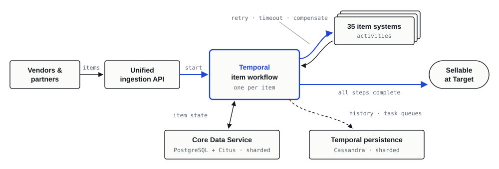
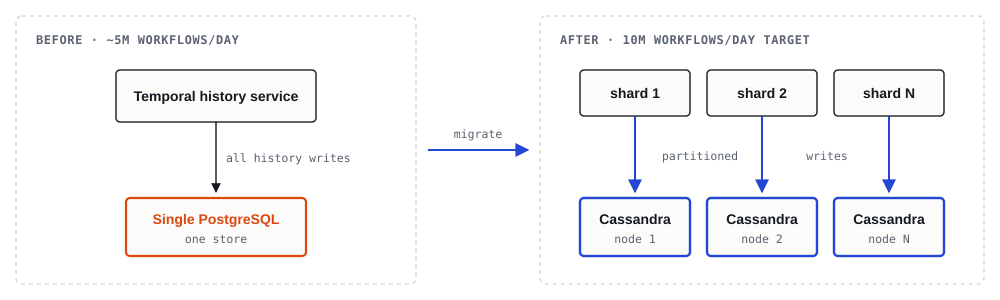
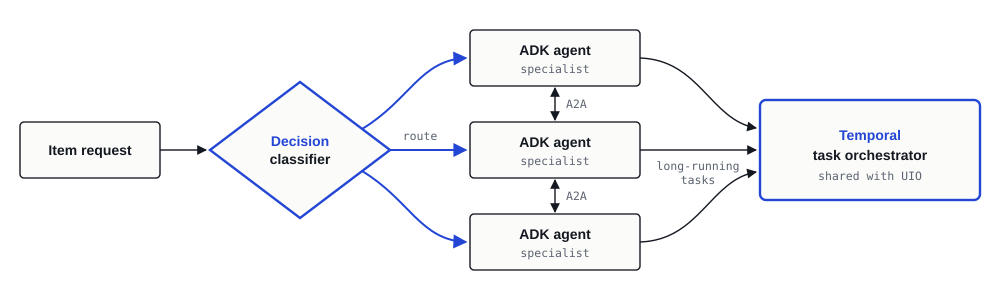
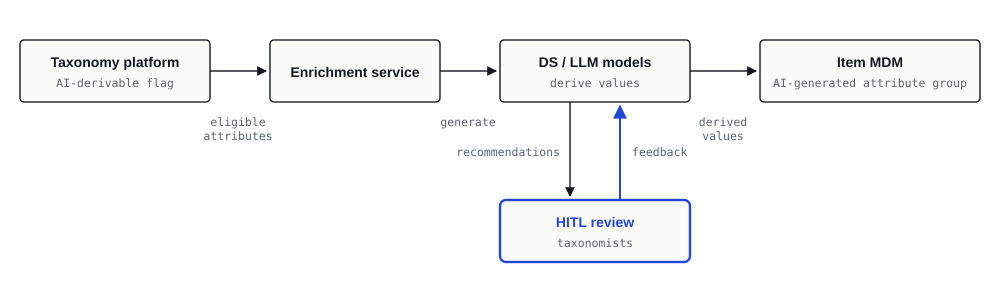

<!-- Profile README for github.com/Sanitdhar — lives in the repo Sanitdhar/Sanitdhar -->

<p align="center">
  
</p>

<p align="center">
  <a href="https://github.com/Sanitdhar">
    
  </a>
</p>

<p align="center">
  <a href="https://www.linkedin.com/in/sanit-dhar-04a341139"></a>
  <a href="mailto:sanitdhar25@gmail.com"></a>
  <a href="https://sanitdhar.github.io/Sanitdhar/"></a>
  
</p>

---

## `$ whoami`

```yaml
name:        Sanit Dhar
role:        Software Engineer @ Target
experience:  9+ years — Target · Falabella · Lowe's · Mphasis
focus:
  - durable workflow orchestration (Temporal)
  - high-throughput ingestion & event-driven microservices
  - distributed data (PostgreSQL + Citus, Cassandra)
  - multi-agent systems (Google ADK, A2A) and LLMs with human-in-the-loop
patterns:    [Saga, CQRS, Event Sourcing, Pub/Sub, BFF]
currently:   scaling Temporal from 5M → 10M workflows/day
ask_me_about: [Temporal internals, sharding Postgres, agent orchestration, spec-driven dev]
```

## 📈 By the numbers

| | | | |
|:---:|:---:|:---:|:---:|
| **10M** items/day<br/><sub>UIO design target</sub> | **35** systems<br/><sub>orchestrated per item</sub> | **200+** stores<br/><sub>on my data plane & BFFs</sub> | **~30%** latency cut<br/><sub>Go promotion engine</sub> |
| **100%** traffic<br/><sub>migrated off a decade-old monolith</sub> | **0%** data loss<br/><sub>store data pipeline</sub> | **~50%** faster<br/><sub>event-driven order creation</sub> | **2M+** req/day<br/><sub>no extra infra cost</sub> |

---

## 🏗️ What I'm building

### 1 · Unified Item Orchestrator (UIO)

The single ingestion route for Target vendors and partners to bring catalog items to sale. Every item runs as a durable, long-running **Temporal** workflow that drives **35 systems** from submission to sellable.

<p align="center"></p>

- Saga-style compensation for partial failures; idempotent activities; workflow state survives worker restarts and downstream outages.
- **Core Data Service** on horizontally sharded **PostgreSQL + Citus** as the platform's system of record.

### 2 · Scaling Temporal: 5M → 10M workflows/day

Moving Temporal's persistence off a single PostgreSQL store onto horizontally sharded **Cassandra**.

<p align="center"></p>

### 3 · Item Agent Orchestrator

A multi-agent platform on **Google ADK**. Agents talk over **A2A**, a **decision-model classifier** routes each request, and the UIO Temporal platform runs the long-running agent tasks.

<p align="center"></p>

### 4 · LLM attribute enrichment with human-in-the-loop

LLMs derive and enrich item attributes. The taxonomy platform controls which attributes AI may derive, and taxonomists review AI recommendations to close the loop.

<p align="center"></p>

### 5 · AI-driven development harness

A harness for my team that sets **team-wide context** for coding agents (Claude Code, OpenCode) through reusable **skills** and skill config, run as **spec-driven development**: spec first, agents implement against it.

---

## 🧰 Tech stack

<p align="center">
  <br/>
  <br/>
  
</p>

<p align="center">
  
  
  
  
  
  
  
  
  
  
  
  
  
  
</p>

---

## 🛤️ Career path

| When | Where | What I built |
|---|---|---|
| 2024 → now | **Target** · Software Engineer | Unified Item Orchestrator (Temporal, 35 systems, 10M/day), Item Agent Orchestrator (ADK + A2A), Citus core data service, LLM attribute enrichment, item taxonomy rewrite |
| 2021 → 2024 | **Falabella** · Senior SWE | Go promotion engine (−30% latency, −10% memory), store data plane to 200+ stores with zero data loss, event-driven order confirmation & store BFFs |
| 2019 → 2021 | **Lowe's** · SWE | Enterprise Cart & Checkout; migrated 100% of traffic off a decade-old system (Spring WebFlux, Couchbase, Kafka) |
| 2017 → 2019 | **Mphasis** · SWE | NEXTSTEP: platform hosting 40 microservices, plus a liveness-monitoring service |

---

## 📊 GitHub activity

<p align="center">
  
  
</p>
<p align="center">
  
</p>

---

<p align="center">
  <sub>Built with durable workflows, sharded tables and a lot of retries. Say hi on <a href="https://www.linkedin.com/in/sanit-dhar-04a341139">LinkedIn</a>.</sub>
</p>

<p align="center">
  
</p>
